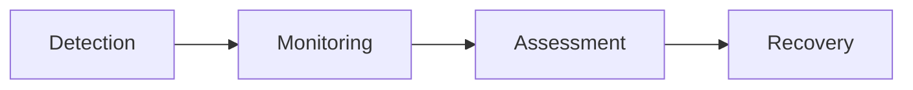
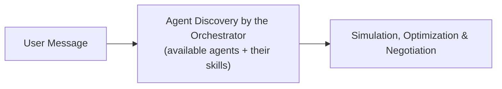
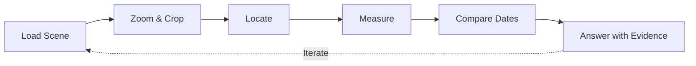
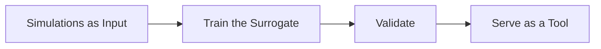
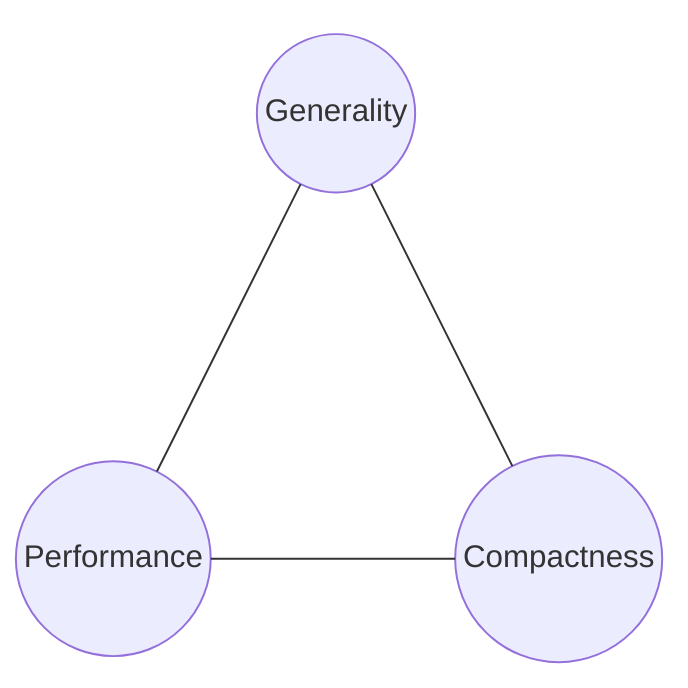

Personal notes from the three-day workshop *Agentic AI for Earth Observation*,
organized by ESA Phi-lab and BIFOLD, with NASA, Ethereum Foundation, and Mistral
among the participants.

The main themes were:

- **Trustworthiness**: how agentic systems can support decisions in Earth
  observation (EO) while remaining reliable and transparent.
- **Foundation and fine-tuned models**: how do foundation models and fine-tuned
  smaller models compare across different tasks?
- **Integration**: how agentic systems will be integrated into production
  environments, with a focus on edge deployments.

The main takeaways were:

- Multi-agent workflows perform better than single-agent ones.
- Many different benchmarks exist, with no agreement on which to use.
- Agents are needed when the answer requires a long workflow over heterogeneous
  data, not a single prediction.
- Small, specialized models, explicit plans and references instead of raw
  rasters make agents cheaper and more reliable.
- Trustworthiness and the boundary between autonomy and human responsibility
  remain open problems.
- The American point of view, compared to the European one, is that they want to
  remove the human from the loop.

### Personal Considerations

1. The human in the loop is the bottleneck. The only thing we can do is create
   proper boundaries with tools so that humans can trust these phases.
1. Many people seem to be building everything from scratch, and there is no real
   reuse of EO tools. Where is the reuse?
1. How can we do hallucination detection? Is it possible to use anomaly
   detection for it?
1. There was little focus on the uncertainty of model predictions, which is
   fundamental for critical decisions. Only a few projects mentioned
   uncertainty.

## First Day

### 1. Motivation: Why Agentic AI for EO?

*Claudio Iacopino (Head of Explore Office, ESA Phi-lab)*

Earth observation is the leading activity of the agency, and
[**FutureEO**](https://www.esa.int/Applications/Observing_the_Earth/FutureEO/Introducing_FutureEO)
is the ESA R&D programme dedicated to it. It is organized in three elements:

- EO Foundations
- EO Missions and Data
- Earth Action: aims to produce concrete actions based on climate and
  environmental data.

Phi-lab is an open lab that carries out research to let a technology mature, and
then invests in it. Its Explore Office covers:

- Foundation models, digital assistants and twins, generative and agentic AI.
- Cognitive space with on-board AI, quantum computing, neuromorphic computing
  and biocomputing.
- Virtual and immersive visualization, distributed ledgers and blockchain.

> Producing EO data alone is no longer enough.

Data must be combined to be understood, and decisions must be taken under
uncertainty. The main applications are disaster and fire management, urban
extreme heat, ship identification and tracking, and national-level intelligence
models.

Two initiatives were presented:

- [**World Agentic Engine**](https://philab.esa.int/event/world-agentic-engine-info-day/):
  an agentic-AI-driven capability able to orchestrate models on top of a shared
  semantic layer. The goal is to align all players in the EO industry to foster
  an efficient use of European EO assets. The concept is integration and reduced
  duplication.
- [**EOCognitiveLab**](https://philab.esa.int/flagship-programmes/): focused on
  AI and a space data center to create an in-orbit laboratory. With two core
  satellites, the goal is to demonstrate autonomous constellation orchestration,
  cooperative sensing and event-driven acquisition replanning.

Four questions guided the workshop:

1. When is agentic AI needed, because classic EO workflows are not enough?
1. How can agentic systems remain trustworthy?
1. How do we move from demonstrations to an interoperable ecosystem?
1. Where should autonomy stop and human responsibility begin?

### 2. Agentic AI for EO and Climate Resilience

*Salman Khan (Professor, Mohamed bin Zayed University of Artificial
Intelligence, MBZUAI)*

A flood map does not give an actionable answer. Decision makers need to know
which schools and hospitals are in the flooded area, which roads still reach
them, and where help should go first.

> Answering complex, decision-related questions requires a **workflow**, not a
> simple forecast.

The proposed progression is:

EO agents are challenging for three reasons:

- Workflows are long: many data sources and models must be combined over a long
  horizon.
- Data are heterogeneous.
- Context explosion: GeoTIFF and GeoJSON files are far larger than the model
  context.

Three works were presented.

#### OpenEarthAgent

- Code:
  [mbzuai-oryx/OpenEarthAgent](https://github.com/mbzuai-oryx/OpenEarthAgent)
- Paper: [arXiv:2602.17665](https://arxiv.org/abs/2602.17665)

The question is whether a 4B model can use geospatial tools. The authors started
from Qwen3-4B, which was not able to order the tool calls correctly, and
fine-tuned it on structured tool-use trajectories. The model follows a Reasoning
& Action (ReAct) loop.

> Tool-selection accuracy is the key metric, because it shows whether the model
> has learned to use the available tools correctly.

The demos included:

- Shortest distances from all kindergartens in an area to the closest police
  station.
- Estimating the heading of the largest aircraft in an image.
- Counting the buildings that remain in a before/after damage image.

They also studied a workflow with two agents, a planner and an executor that
calls the planned tools. Multi-agent workflows achieved better results.

#### GeoFaham

- Code: [microsoft/GeoFaham](https://github.com/microsoft/GeoFaham)

"Faham" is an Arabic-origin word meaning understanding. The system has an
orchestrator and four specialist agents: vector, map, STAC and raster. The demo
identifies the schools close to a flood. It is evaluated on **GeoFaham-Bench**,
with 40 tasks from 17 real disasters. The system is built on OpenAI models, and
each task is assigned to a suitable model to optimize cost. They noted that
GPT-4o performs very well as the STAC and raster agent.

#### TerraBench

- Paper: [arXiv:2606.13148](https://arxiv.org/abs/2606.13148)

The question is whether agents can reason over heterogeneous Earth system data
(reanalysis, forecasts and so on). An example task is: *how much rain fell over
agricultural land with NDVI > 0.2?*

In the rainfall example, Sonnet's answer was $14 \times$ higher than the
reference.

#### Lessons Learned

- Small specialized models can compete with bigger generic models.
- Make the plan explicit.
- Pass references instead of raw rasters.
- Score the answer, not only the recipe (the workflow).

### 3. Agentic Decision Intelligence and Earth Action

#### A Decision-Driven, Hazard-Agnostic AI Framework for Earth Observation: Demonstration Through a Flood Response Use Case

*Firoozeh Foroozan and Carlos Pino Padilla (Indra Space)*

The goal is to transform the volume of EO data into timely decisions. The flood
segmentation model, [DeepLabV3+](https://arxiv.org/abs/1802.02611), is the
foundation of the system. The agents are orchestrated with
[LangGraph](https://github.com/langchain-ai/langgraph), and the workers have no
edges between them: they communicate only through the orchestrator.

#### Multi-Agent Early Extreme Events Detection from IoT to Earth Observation Tasking

*Arnauld Le Carvennec and Axel Gruyez (CS Group)*

Transformer- and agent-based extreme event detection. Extreme events are
becoming more frequent and dangerous, which motivates automatic detection.

#### Wildfire Lifecycle Monitoring from Earth Observation

*Rishi Madhok and Fuxun Yu (TerraByte AI)*

The lifecycle is:

The FireTrack model is based on VIIRS and uses either a CNN or the frozen
[Prithvi-EO-1.0-300M](https://huggingface.co/ibm-nasa-geospatial) encoder, with
skip connections to a U-Net decoder.

- Related code (VIIRS fire tracking, NASA EIS):
  [Earth-Information-System/fireatlas](https://github.com/Earth-Information-System/fireatlas).

#### Agentic Orchestration of EO Foundation Models via Model Context Protocol

*Pinaki Banerjee and Rocco Sedona (Jülich Supercomputing Centre)*

The goal is to make AI tools available to people who are not familiar with EO.
The work used TerraMind v1 large.

- Model: [IBM/terramind](https://github.com/IBM/terramind)
- Fine-tuning toolkit: [IBM/terratorch](https://github.com/IBM/terratorch)

#### TerraScope: Pixel-Grounded Visual Reasoning for EO

*Yan Shy (University of Trento)*

An interesting talk about a model that handles both segmentation and analysis in
one system, interleaving pixel-level masks with textual reasoning.

- Paper: [arXiv:2603.19039](https://arxiv.org/abs/2603.19039)

### 4. Earth Observation in the Age of Agentic AI: From Insight to Business

*Julia Gottfriedsen (CTO, Constellr), Marcin Detyniecki (AXA), Andres Camero
(DLR) and Linda Sheard (Xoople)*

### 5. Subway Takes: Agentic AI Edition

*Eva Gmelich Meijling and Riccardo D'Ercole (ESA Phi-lab)*

Each participant proposed a take on agentic AI, and after a vote the open
discussion started. Three points were discussed:

- Is agentic AI making scientific research less scientific? What happens when
  non-expert people use models without knowing the theory behind the
  application?
- Should the validation of scientific publications via agentic AI be a goal?
- How many foundation models do we need? Is one enough, or do we need many?
  Would a good coordinator with many specific models be better?

## Second Day

### The Rise of Agentic AI

*Jacopo Chevallard (AI Development Strategist, Mistral AI)*

The talk focused on the product they developed with an open-weights model.

Topics:

- Ecosystem dynamics
- Four levers for builders of EO agents
- Implications

General AI agents still get only a third of EO questions right, despite the huge
number of scientific contributions on agentic EO.

The skeleton is always the same: an LLM and tools.

> The central planner is the most important element because it is the shared
> critical component.

Who builds the intelligence layer? This is important for Europe, which needs
control in the AI revolution and therefore needs to own the intelligence layer.

Mistral started investing in compute capacity, specifically sovereign compute
capacity, and is working with TotalEnergies on geoscience models. Companies have
understood that they cannot rely on external API calls or external intelligence
layers.

#### Part 1

The [OSWorld](https://osworld-v1.xlang.ai/) benchmark gives an indication of the
capabilities of foundation models and agentic AI in a multimodal setting, but it
does not generalize to specific fields like EO.

Open models trail the closed frontier models by about four months. Most of them
come from China (8 of the top open models are Chinese), but Europe is back in
the race.

> The cost of intelligence is falling by 13x per year.

Open interfaces like Model Context Protocol
([MCP](https://github.com/modelcontextprotocol)) and Agent2Agent
([A2A](https://github.com/a2aproject/A2A)) have become standards under the Linux
Foundation, no longer controlled by private parties. We can therefore build EO
tools once as MCP servers and reuse them anywhere.

The first layer of a sovereign AI is made of four kinds of sovereignty:

- **Data sovereignty**: keep critical knowledge and secrets. Intellectual data
  should stay in our system, and the model should come to the system.
- **Intelligence sovereignty**: with the model in the system, we can fine-tune
  it on internal trajectories and *compound* this intelligence over time.
- **Compute sovereignty**: you should choose where to run AI models. We need
  regional inference.
- **Operations sovereignty**: control the entire end-to-end agentic stack.

#### Part 2

The four levers are:

- Reliability
- Vision
- Specialization
- Training

Reliability is the major limitation, because agents fail, especially in EO. It
should come from what surrounds the model, namely tool calls.

> We should have a verification layer at every step (raster, physics, metadata).

Even though reasoning models are becoming very capable, SAR, multispectral and
time-series data still need EO foundation models and tools.

Small specialized models beat large general ones on narrow tasks. An example is
the EVE project, trained on
[Mistral Small](https://mistral.ai/news/mistral-small-4/).

For training, they have recently focused on mid-training and online RL, where
the reward comes from a verifier rather than a label.

> A small model trained with online RL can beat much bigger models.

Science means reproducibility! We touched on this topic yesterday in the final
discussion. For agentic systems we also need to freeze the agent's world: the
traces of the model should be published and the model version pinned.

LLMs are very well suited to training surrogate models from simulations. This is
an offline flywheel: create the surrogate model, then use it as a tool that the
agent can call. This way we can get an answer in a few seconds.

The model is temporary, because foundation models are released quickly. The real
assets are the data, the evaluations and the traces.

Chinese companies dominate the open-weights landscape. The scaling law has been
confirmed, and more compute means a better model. Money is also a problem,
because Mistral pays for energy in the same way everyone else does, while
Chinese companies have government funding.

### FAME: Traditional and Agentic AI in Space

*Steve Chien (AI Group, NASA JPL)*

FAME is an effort to demonstrate coordination across a fleet of autonomous
spacecraft: coordinating activities, measurements and insights.

Dynamic Targeting (DT) makes AI decisions in under 60 seconds, so the satellite
itself can interpret the data it collects. The project is a collaboration with
Ubotica and Open Cosmos. They expect DT to become commonplace across many future
Earth science missions.

Another focus is onboard scheduling, so that the spacecraft can manage its own
resources.

They are also using large models to generate goal-based behavior in space. For
example, a VLM can take an image of a fire, use tools such as wind, air quality
and trajectory calculation, and decide whether actions are needed for health and
agricultural purposes.

Other examples are zero-shot scene classification, open-vocabulary detection and
localization, visual question answering (VQA) and open-ended queries (for
example, "how many quadjets are visible in the image?").

He sees scene classification as the main application of LLMs in orbit, although
they have been working on specialized classifiers for decades.

### Autonomous EO Systems, Space Operations and Cognitive Computing in Space

#### Agentic Orchestration of Satellite Tasking and Data Retrieval in Earth Observation Virtual Constellations

There are two kinds of agents in the agentic orchestration layer: an
orchestrator and mission agents, which communicate via the A2A protocol.

The flow is:

The negotiation happens among the agents to get the best acquisition for the
case at hand.

#### Autonomous Agentic Command and Control for Satellite Constellations: An AI-Accelerated Engineering Demonstration

*Alessio Auddino (Thales Alenia Space)*

Managing large fleets is becoming more complex because the number of satellites
keeps growing. Connecting the nodes is hard because it is a distributed-system
problem.

The AI agent flow is:

They used LangGraph and Kubernetes for the production environment.

#### Toward Cognitive Cloud Computing in Space: AI-eXpress as an Orbital Testbed for Agentic Earth Observation

*Marco Bucci Beltrami (Planetek Italia)*

Problems:

- High latency between collection and delivery to the user.
- Missed observations because of clouds.

It is therefore difficult to react quickly to observations.

AI-eXpress is a fleet of satellites composed of three nodes.

There are three steps towards agentic EO:

- Planning: what should we observe?
- Processing: agentic edge processing.
- Collaborative multi-agent operations.

The hardware used was [Unibap](https://unibap.com/solutions).

#### Agentic Mission Computing for Autonomous Earth Observation

*Leonidas Kosmidis (Metasat)*

> How can we enable onboard AI for institutional missions?

The SHERPA project focuses on extreme events and on performing computation on
board. This requires far more computing power than current hardware can provide.

He mentioned that Linux is not considered safe, so they used an FPGA. ESA
dictates which software and hardware can go into a mission based on its type and
cost. Class 1 is the strictest mission class. Linux is so big that it is not
possible to prove that it meets all the requirements.

> The simpler the software, the easier it is to verify the requirements.

Example usage:

- A U-Net for cloud screening.
- YOLOX-Tiny for object detection.

#### Closing the Reasoning Latency Gap: FPGA-Accelerated LLM Agents for Onboard Supervision of Earth Observation Acquisition

*Winfred Ooh-Azlin (TU Berlin)*

A Qwen2.5-1.5B model, quantized to 4 bits, ran on a single Cortex-A72 CPU core
without an accelerator.

### From Earth Observation to Earth Intelligence: Opportunities, Challenges and Future Directions

*Mikhail Klassen (Planet Labs), Bertrand Le Saux (DG CONNECT) and Ioannis
Papoutsis (National Technical University of Athens)*

What does Earth intelligence mean?

The stack is:

- Data stack
- Models and compute layer
- Agent and query layer

In the future there will be digital twins and Earth models. We are moving from
only observing to deciding what to do.

Technical problems in agentic systems, and where to focus:

- We don't have time-series foundation models.
- Physical consistency is missing in LLMs.
- There is no agreement on which benchmarks to use, and on the existing
  benchmarks agentic systems perform very poorly.

> How should we trust the output of agents? How much autonomy should we allow?

We should add autonomy, observe the failure modes and fix them. Step by step,
all autonomous systems will follow the same path as autonomous cars.

Earth intelligence is growing very fast. What will it look like in 5 to 10
years? Something very multimodal and very low resolution.

### Design, Development and Evaluation of AI Agents

#### Collaborative Agent Reasoning Engineering (CARE): A Structured Context Engineering Methodology for Systematically Designing Traceable and Maintainable AI Agents for Science

*Rohit Sisir Sahoo (University of Alabama)*

#### Evaluating an EO-Specialized LLM in Agentic Frameworks

*Riccardo D'Ercole (ESA Phi-lab)*

The goal was to put EVE into a proper agentic framework. Are specialized models
good at orchestrating specialized tools?

EVE is built on Mistral Small 3.2 24B, and they built a suite of models. EVE was
very good at orchestration but not at efficiency.

They designed PhiLiveBench.

> Domain specialization does not automatically translate into agentic
> performance.

#### EO Agent Arena, an EO-Specialized LLM, in Agentic EO Systems

*Najah Pokkiri (Axis Spatial)*

Which AI model is best for geospatial work? Geospatial AI has no shared
leaderboard.

#### Behavioural Self-Monitoring for Autonomous EO Agents: The Attribute Reliability Monitor (ARM)

*Alejandro Mousist (Thales Alenia Space)*

They recently started working on thermal infrared, which is not a very common
modality. The CTO of Constellr also mentioned it.

They created their own VLM and used the SPARK dataset.

> Agents should monitor their tools, because there is no ground truth in space.

#### Balancing Accessibility and Scientific Validity in the Era of AI Agents and Climate Change

*Elena Di Medio (Lobelia Earth)*

How can AI tools simplify accessibility?

#### From Tools to Ecosystem: EVE's Community-Driven MCP Registry for an Agentic Platform for Earth Intelligence

*Alex R. Atrio (Pi School)*

An explanation of the EVE platform. EO resources are fragmented, and access to
them is manual.

- EVE-Instruct was the goal of phase 1. It has RAG for scientific data.
- Phase 2 is the planning and tool-invocation layer over the catalogue.
- The open part is for now limited to retrieval.
- There are 28 tools so far, covering wildfire, disaster, geocoding and more.
- It follows open standards.
- The tool registry is curated and limited to EO services.
- All tool calls are auditable with the trace.
- The EVE platform is model-agnostic. The default model is EVE-Instruct, but the
  two are distinct.

The orchestrator agent has:

- Core tools
- Tool search
- Skill index
- Spawn agent: agents can be shut down.

### Building with Mistral Open Agentic AI Tools: From Scientific Discovery to Operational Services

There is no specific answer to when to use a small model and when to use a big
one.

Image loop:

A typical task takes 6 to 10 tool calls.

Pipeline:

Pixtral-12B + LoA.

**Timestral** is a time-series foundation model that has just become competitive
with boosting techniques for time series. It is very small, has the best
performance, and is open-weights. It works zero-shot, compared with XGBoost.

Physics surrogate:

#### Part 2

Forge is for model customization, and Studio allows building workflows.

> Mistral's goal is to embed the AI product in your system.

Mistral Vibe is like Claude Code but allows self-hosted models.

With Forge you can fine-tune your own model.

How EVE was trained:

1. Curate an EO corpus.
1. Generate synthetic data (a phase of paramount importance for all models).
1. Fine-tune Mistral Small.
1. Evaluate on an EO benchmark.
1. Add retrieval and checks.
1. Serve with MCP tools.

## Third Day

### Building Robust Economic Capabilities in AI Agents

*Davide Crapis (Ethereum Foundation)*

ESA Phi-lab collaborates with the Ethereum Foundation to investigate possible
applications of markets for EO data in space.

### Why Mature Agents Require a Paradigm Shift in Tooling

*Christopher Forrest Brown (Google DeepMind)*

EO problems are not formally verifiable and are not quick to evaluate, so they
are hard for agents to solve. Solutions are not programs that can be executed.
Agents can mainly act as orchestrators of GIS tools.

Custom harnesses depreciate over time, because general tool chaining improves as
models scale.

> Research SOTA differs from operational SOTA.

Embedding products face a trilemma:

The information that goes into the embedding has to be chosen before the
embedding is created, so it does not generalize. Embeddings don't solve
everything.

Startups begin by building products around applications that were not possible a
year earlier, but models do not transfer.

He is a foundation-model skeptic. A lot of focus goes to the task, which is
something state-of-the-art models do not consider.

The best tools we can provide to agents won't be EO models, but structured
knowledge.

It is faster to review code than to write it (the classic P vs NP problem).
Focus on EO data, workflow traces and domain expertise, and use agents to
*build* the next generation of tools.

AlphaEarth started as a project on embedding fields. The goal was to create a
synthetic satellite that can answer questions at any resolution, for any place,
at any time.

Self-supervision helps make our discontinuous data continuous (swaths and
differences in time), as the world actually is.

He recommended focusing on:

- Using all the available data, such as a small dataset of worms with only six
  samples.
- Integrating new satellites with sensors that have no history.

### Multimodal Large Language Models, Datasets and Agentic Earth Intelligence

#### APERTURE: Semantic Change Understanding and Grounded GeoAI Reasoning via SAR-Optical Language Alignment

*Magdalena Kaiser (LiveEO)*

They tried optical and SAR data but did not get good results, because the model
did not use SAR during fine-tuning. The VLM was only able to detect disappearing
objects.

They created a new dataset, GeoCap, with optical and SAR data, and want to build
a SAR-optical aligned vision encoder to see whether SAR adds value.

#### BigEarthNet.txt: A Large-Scale Multi-Sensor Image-Text Dataset and Benchmark for Earth Observation

*Mathis Jürgen Adler (TU Berlin)*

Data is the problem.

#### Toward Agentic and Unified Agricultural Field Boundary Delineation from Satellite Imagery Using Geospatial Foundational Models, Pre-Trained Segmentation and Embeddings

*Sayantan Majumdar (DRI)*

#### Evaluation of Agentic Autoresearch on an Earth Observation Benchmark

*Alex Lopez-Cifuentes (Xoople)*

This work builds on
[Karpathy's autoresearch](https://github.com/karpathy/autoresearch) and extends
the idea to Earth observation.

How capable are current frontier LLMs, in an agentic setup, at training better
EO models? They used the [PANGAEA benchmark](https://arxiv.org/abs/2412.04204)
with two setups:

1. A fixed U-Net.
1. A free architecture search.

A data agent set up the PANGAEA benchmark, from downloading the data to
verifying the baseline. A model agent handled hypothesis drafting, model
training and validation. The best configuration is then retrained with the full
protocol.

> Watch out for metric gaming by the models during training.

#### GeoFMOps: An Agentic Framework for the Geospatial Foundation Model Lifecycle in Earth Observation

*Fabrizio Rosmarino (University of Bari and Planetek Italia)*

Using a GeoFM within an agentic framework.

How can the foundation-model lifecycle be automated (model selection, onboard
deployment) without losing quality and control?

See also AI-eXpress.
