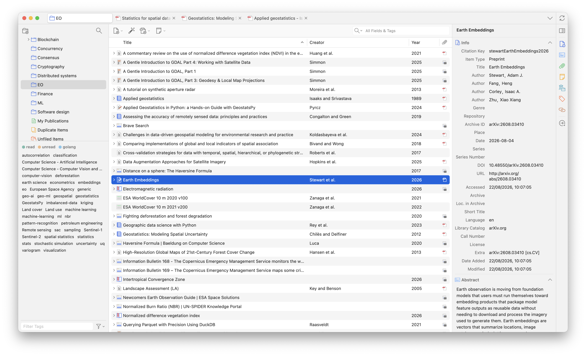
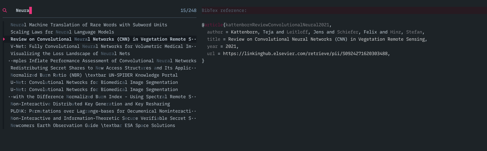

## Introduction

Every time I write something, from a scientific paper to a blog article, I run
into the same problem: organizing and citing a bibliography without it becoming
its own chore. I've tried several tools over the years, but the excitement
always faded within a few days, just long enough to finish the setup before old
habits crept back in.

After some research, I came across [Zotero][zoteroyourpersonal], a free and open
source personal research assistant that makes it easy to keep track of every
resource you use to learn, write, or work. Since I started using [Neovim], I've
tried to build my workflows around the terminal, from coding to note-taking,
with one goal of having zero friction in the actions I have to perform. Giving
proper credit to other people's work matters too much to let friction get in the
way.

Zotero itself is great, but it still meant leaving the terminal: switching to
the Zotero app, searching for the source, copying the link, and going back to
build the markdown citation by hand. What follows isn't just "how to use
Zotero", but it's a presentation of a small Lua script that lets you search and
insert a citation without ever leaving the markdown file you're writing in
Neovim.

In the next sections, I'll walk you through the workflow I built to remove that
friction, using three simple tools: Zotero, Neovim, and
[Lua][programminglanguagelua]. The goal I was targeting was simple:

> I wanted a way to search in my bibliography, select a resource, and
> automatically create a markdown citation without having to leave the Neovim
> tab with the article I'm working on.

Let's dive in!

## Links in Markdown

If you are familiar with [Markdown][basicsyntaxmarkdown], you probably are used
to create links in the following way:

```md
[Name of the resource]("https://...")
```

Nothing is wrong with this approach, and it is what I also do most of the time.
However, if you have to cite the same resource multiple times, this solution is
against the `don't repeat yourself` philosophy, and this is where the
`reference-style approach` comes to the rescue. This approach is based on two
steps:

1. Create a reference citation key and link with the **anchor** element.
1. Create a pointer inline to the **anchor** element which we can call the
   **citation**.

With this approach we can have a single source of truth that contains a single
citation text which is usually autogenerated by tools like Zotero, and then we
can reference it in our documents every time with different displayed text.

What we have to do is pretty simple and we can see how to do it for the
reference to the Neovim software. First add the anchor part as follows at the
very bottom of your file:

```md
[neovim]: https://neovim.io/ "Neovim"
```

Then, every time we want to cite Neovim in the text, we just have to write:

```md
You know, [the open-source Neovim][neovim] is an amazing tool for coding and writing.
```

Where the second part is the reference to the anchor, and the first part is the
text to display.

What I also like to do, is to always add a `## References` section at the end of
the documents where I report all the ordered citations I included in the doc.
Notice that I do this because the anchor part remains invisible in the document,
so if you want to have access to all the resources cited or used for the
writing, this is the approach. The anchor part can be seen as the programming
equivalent of an object. Once you create it, it contains all the information
that characterizes it, but you can assign it to new variables or use its
information somewhere else. In detail, an anchor element is composed of:

- The citation key
- The link to the resource
- A title assigned to the resource

The title, which is the text enclosed in quotation marks, is what appears as a
tooltip when the user hovers over the link.

## Zotero

As mentioned previously, Zotero is an open source project that allows you to
easily keep track of the resources you use in your research. With this tool, you
can easily create bibliography entries, search for resources via DOI, modify
resource metadata, create collections, add tags, and perform many other actions.



After installing Zotero on your machine, there are two other steps we should go
through, one optional, and one not. The optional step, which I really recommend,
is the installation of the [Zotero connector](https://www.zotero.org/download/)
on your browser. With this extension, you can add a new item into your
bibliography at the speed of one click! When you find a nice article or website
that you want to track, you can just press the connector icon, select the
collection where you want to store it, add tags if you want, and you're done!
You don't have to leave the browser to collect a reference, and you can continue
reading the resource.

The second step is required to follow along with the next section, and it is the
installation of the
[Better BibTex for Zotero](https://retorque.re/zotero-better-bibtex/). With this
plugin we can manage bibliographic data in an easier way and fully customize how
this is done. After installing it, you can configure it by going in
`Zotero > Settings > Better BibTex`. Here you can for example modify how the
citation key is constructed from the citation metadata. In the settings you
should now update two sections:

- In the `Export > BibTex` section, below the **Add URLs to BibTex export**
  select `in the 'url' field`. This is required to have the URL in the
  bibliography that we can later use to construct the markdown link.
- In the `Automatic Export` section, configure the setting as you like, and
  specify the location and name of your `.bib` file that will contain all your
  references. In my case, here I've also selected that when both a DOI and a URL
  are present both should be exported.

Below is an entry in my bibliography document, automatically exported from
Zotero, containing both a link and the DOI:

```bib
@techreport{butlerGeoJSONFormat2016,
  type = {Request for {{Comments}}},
  title = {The {{GeoJSON Format}}},
  author = {Butler, H. and Daly, M. and Doyle, A. and Gillies, Sean and Schaub, T. and Hagen, Stefan},
  year = 2016,
  month = aug,
  number = {RFC 7946},
  institution = {Internet Engineering Task Force},
  doi = {10.17487/RFC7946},
  url = {https://datatracker.ietf.org/doc/rfc7946},
  urldate = {2026-04-24},
  abstract = {GeoJSON is a geospatial data interchange format based on JavaScript Object Notation (JSON). It defines several types of JSON objects and the manner in which they are combined to represent data about geographic features, their properties, and their spatial extents. GeoJSON uses a geographic coordinate reference system, World Geodetic System 1984, and units of decimal degrees.},
  file = {/Users/stepit/Zotero/storage/BEFSICGJ/Butler et al. - 2016 - The GeoJSON Format.pdf}
}
```

If you are interested, you can find the entire configuration I use in my
[dotfiles repo](https://github.com/0xstepit/dotfiles/blob/main/.config/better-bibtex-config.json).

### Sync Zotero file

Zotero stores the files downloaded with the connector or manually added in a
local folder. You can sync this folder to the cloud to make it available to all
the other devices using Zotero. This is particularly useful if you are used to
highlighting or taking notes on the files you read, because this way you can
read from a tablet, add your highlights, and have them available also on your
computer. There are two ways to achieve this goal:

- Use the Zotero cloud, which is very limited in the free version, but you can
  pay for more.
- Connect Zotero via the standardized file exchange format on the Web called
  WebDAV. In my case, I'm using the 10GB offered for free on
  [KOOFR](https://koofr.eu/blog/posts/koofr-with-zotero-via-webdav). The WebDAV
  login has to be configured on all the devices you want to use.

You can get more information about Zotero sync on their
[official documentation](https://www.zotero.org/support/sync).

## Neovim and Lua

In the previous two sections we described two processes:

- How to keep track of all the references.
- How to add a reference in a markdown document.

What is missing here is the coolest part, the automatic approach that allows us
to insert a citation from the available ones without ever leaving the markdown
file.

In achieving our goal, we will use two tools:

- The [fzf-lua](https://github.com/ibhagwan/fzf-lua) plugin that allows you to
  use [fzf](https://github.com/junegunn/fzf) directly from Neovim. If you never
  used it, fzf is a general-purpose command-line fuzzy finder that helps you in
  finding files and text in your documents and file system in a programmable
  way.

- A bit of Lua. The great improvement of Neovim over the old Vim is the
  possibility to use a general-purpose language to extend what the source code
  allows you to do. In this way, you can add, or better program, whatever
  functionalities you want in your text editor.

### Citation process implementation

Let's dive into the code to see how we can program the fuzzy citation finder.
For the moment the logic is implemented directly into the Neovim configuration,
but it can be easily extracted into a plugin that other people can import and
use in their config.

The first step, to reduce the number of hardcoded variables in the tool, is to
define a variable in your `.env` file containing the path to your bibliographic
file. In my case, I keep the file along with all the notes I write, and so I
defined the variable as:

```sh
export BIB="$KNOWLEDGE_BASE/references.bib"                     # bibliography file
```

Now, we need to first give a bit of context on how a Lua project is structured,
with particular focus on the Neovim configuration. My Neovim config is
structured as follows:

```txt
.
├── after
│   ├── ftplugin
│   └── queries
├── init.lua
├── lazy-lock.json
├── lsp
│   └── ...
├── lua
│   └── stepit
├── snippets
│   └── ...
├── spell
│   ├── ...
```

Everything inside the `lua/` folder is imported and executed from the `init.lua`
file. In the `lua/` folder we then define our specific Nvim configuration. In my
case, the configuration is namespaced with `stepit`, and below are the folders
and files involved in the project we are exploring:

```txt
.
├── custom
│   ├── init.lua
│   └── markdown
│       ├── init.lua
│       └── citations.lua
├── plugins
│   ├── init.lua
│   └── fzf-lua.lua
```

The `citations.lua` file contains all the functions used to read and parse the
Better BibTex bibliography file, and the `fzf-lua.lua` plugin is what is used to
wire all the functions and calls into the fzf utility.

I will not dive much into how Lua manages your modules (if you're new to it, the
[Lua manual][programminglanguagelua] covers `require` and module paths in more
detail), but you have to import submodules in cascade starting from the root of
your project with the `init.lua` file. For example, after the `custom` module is
loaded from a parent, you can chain the import of the `markdown` package and its
content with:

```md title="custom/init.lua"
local self = ...
require(self .. ".markdown")
```

```md title="markdown/init.lua"
local self = ... -- resolves as "stepit.custom.markdown"
require(self .. ".citations")
```

Let's dive into the implementation!

#### citations.lua module

We will use a single class:

```lua title="markdown/citations.lua"
local M = {}

M.default_config = { 
  -- ...
}

return M
```

With 5 methods:

```lua title="markdown/citations.lua"
function M.get_references_file()
  -- ...
end

function M.parse_references(content)
  -- ...
end

function M.parse_better_bibtex_field(entry, name)
  -- ...
end

function M.bib_to_text(entry)
  -- ...
end

function M.create_md_link_from_reference(reference)
  -- ...
end
```

Now I will present the methods of the class with the same logical order in which
they will be used in the `fzf-lua` call. The main entrypoint is the
`get_references_file()` method:

```lua title="markdown/citations.lua"
function M.get_references_file()
  local bib_path = os.getenv("BIB")
  if not bib_path or bib_path == "" or vim.fn.filereadable(bib_path) == 0 then
    vim.notify("Bibliography file not found: " .. bib_path, vim.log.levels.ERROR)
    return
  end
  local f = io.open(bib_path, "r")
  if not f then
    vim.notify("Error reading bibliography file: " .. bib_path, vim.log.levels.ERROR)
    return
  end
  -- Open the file and read all.
  local content = f:read("*a")
  f:close()
  return content
end
```

The function reads from the environment variables the one we configured before
to point to the references file. Then, it performs some checks on the sanity of
the file, and if everything is fine, loads the content, closes the file, and
returns the content to the calling context. Now, we need something to process
the content of the file, parsing it into a structure useful for our workflow:

```lua title="markdown/citations.lua"
function M.parse_references(content)
  local entries = {} -- citation key to reference entry map
  local summary = {} -- lines to display in fzf
  local summary_to_citekey = {} -- map a display line with a citation key

  for entry in content:gmatch("@[%w]+%b{}") do
    local type = entry:match("^%s*@(%w+)%s*{"):lower()
    local citekey = entry:match("@[%w]+{([^,]+),")
    if citekey then
      local title = M.parse_better_bibtex_field(entry, "title") or ""
      local author = M.parse_better_bibtex_field(entry, "author") or ""
      local year = M.parse_better_bibtex_field(entry, "year") or ""
      local url = M.parse_better_bibtex_field(entry, "url") or ""

      entries[citekey] = {
        type = type,
        key = citekey,
        title = title,
        author = author,
        year = year,
        url = url,
      }

      local ref_summary = string.format("%s │ %s (%s) │ %s", citekey, author, year, title)

      summary_to_citekey[ref_summary] = entries[citekey]

      table.insert(summary, ref_summary)
    end
  end

  return {
    summary = summary,
    entries = entries,
    summary_to_citekey = summary_to_citekey,
  }
end
```

The function parses the file content to create the data structures we need. More
precisely, we parse it to create:

- The **summary**: contains the information from the references presented to the
  user during the search.
- The **entries**: a map linking a BibTex citation key to an entity containing
  the selected information for each reference.
- The **summary to citekey**: a map linking each summary string to a BibTex
  citation key.

This function basically defines the flow of the execution. We present the user
with the title of each reference from the summary elements, then, after the
selection, we can use the whole summary string to get the citation key, and from
it, the link inside the associated entity. We could simplify this to a single
hop instead of two, but I preferred to keep the script open to future
extensions.

This function uses a utility to centralize the way a single field in each
reference is parsed from the BibTex format:

```lua title="markdown/citations.lua"
function M.parse_better_bibtex_field(entry, name)
  local v = entry:match(name .. "%s*=%s*{(.-)}%s*[,\n]")
    or entry:match(name .. '%s*=%s*"(.-)"%s*[,\n]')
    or entry:match(name .. "%s*=%s*([^,\n}]+)")
  if v then
    v = v
      :gsub("[{}]", "")
      :gsub("^%s+", "")
      :gsub("%s+$", "")
  end
  return v
end
```

In the visualization we show the user the reference content from our `.bib`
file, so we need something to write the content into a multiline string that the
plugin can then show to the user:

```lua title="markdown/citations.lua"
function M.bib_to_text(entry)
  local out = { ("@%s{%s,"):format(entry.type or "misc", entry.key or "") }
  for _, field in ipairs(M.default_config.fields) do
    if entry[field] and entry[field] ~= "" then
      out[#out + 1] = ("  %s = %s,"):format(field, entry[field])
    end
  end
  out[#out + 1] = "}"

  return table.concat(out, "\n")
end
```

The last remaining thing is the creation of the markdown link and the collection
of all the information we want to provide at the end of the execution:

```lua title="markdown/citations.lua"
function M.create_md_link_from_reference(reference)
  if not reference.url or reference.url == "" then
    vim.notify("Selected entry does not have an URL", vim.log.levels.WARN)
    return "", "", ""
  end

  if not reference.key or reference.key == "" then
    vim.notify("Selected entry does not have a citation key", vim.log.levels.WARN)
    return "", "", ""
  end

  local ref_text = string.format("[%s]", reference.key)
  local link_text = string.format('[%s]: %s "%s"', reference.key, reference.url, reference.title)
  return ref_text, link_text, reference.title
end
```

#### fzf-lua.lua plugin

Import the citation module at the top of the file:

```lua title="plugins/fzf-lua.lua"
local citations = require("stepit.custom.markdown.citations")
```

Now, we can wire everything up by adding a new keymap in the `keys` map of your
`fzf-lua` configuration:

```lua title="plugins/fzf.lua"
{
  "<leader>fc",
  function()
    -- Implementation goes here.
  end,
  desc = "Insert BibTeX citation",
}
```

This way, we can trigger whatever we add in the implementation by pressing the
leader key you configured followed by `fc`. So, what should we add in the
function now?

The first step is to load the reference file content, parse its content, and
short-circuit an exit if it is empty or not valid:

```lua title="plugins/fzf-lua.lua"
local content = citations.get_references_file()
if not content or content == "" then
  vim.notify("Bibliography file is empty" .. content, vim.log.levels.WARN)
  return
end

local parsed_references = citations.parse_references(content)
local summary = parsed_references.summary
local entries = parsed_references.entries
local summary_to_citekey = parsed_references.summary_to_citekey

-- Case in which the reference file is empty after parsing.
if #summary == 0 then
  vim.notify("No entries parsed from reference file", vim.log.levels.WARN)
  return
end
```

Now that we have the content to display to the user, we need to create an
`fzf-lua` custom previewer to customize how to provide this information to the
user:

```lua title="plugins/fzf-lua.lua"
local builtin = require("fzf-lua.previewer.builtin")
local BibPreview = builtin.base:extend()

function BibPreview:new(o, opts, fzf_win)
  BibPreview.super.new(self, o, opts, fzf_win)
  setmetatable(self, BibPreview)
  return self
end

function BibPreview:populate_preview_buf(entry_str)
  local ref = summary_to_citekey[entry_str]

  local text
  if not ref then
    text = "(no match for line)\n" .. entry_str
  else
    text = citations.bib_to_text(ref)
  end

  local buf = self:get_tmp_buffer()

  vim.api.nvim_buf_set_lines(buf, 0, 2, false, { "BibTex reference:", "" })
  vim.api.nvim_buf_set_lines(buf, 3, -1, false, vim.split(text, "\n", { plain = true }))

  vim.bo[buf].filetype = "bib" -- enable color hi for bib files.
  self:set_preview_buf(buf)
  self.win:update_preview_scrollbar()
end

function BibPreview:gen_winopts()
  return vim.tbl_extend("force", self.winopts, { wrap = true, number = false })
end
```

We are basically showing the reconstructed BibTex reference in a buffer of
filetype `bib`, so we can nicely visualize the colored preview.

```lua title="plugins/fzf-lua.lua"
require("fzf-lua").fzf_exec(summary, {
  prompt = require("stepit.utils.icons").symbols.lens .. "    ",
  previewer = BibPreview,
  actions = {
    -- ...
  },
  fzf_opts = {
    ["--delimiter"] = "│",
    ["--with-nth"] = "3",
  },
})
```

Where the `fzf_opts` allows us to customize how the summary lines are visualized
in the UI. If you remember, each summary line was formatted as
`string.format("%s │ %s (%s) │ %s", citekey, author, year, title)`, but we only
want to show the user the title. So, we split the string at `"│"`, and then keep
the third slice.

Now the important part, the actions. Actions are used to customize the behavior
of how the selected item is handled, and what happens after. We configure only
the default one as:

```lua title="plugins/fzf-lua.lua"
["default"] = function(selected)
  if not selected or #selected == 0 then
    return
  end

  local citekey = selected[1]:match("^(%S+)")
  if not citekey or citekey == "" then
    vim.notify("No entries associated with the selected reference", vim.log.levels.WARN)
    return ""
  end

  local entry = entries[citekey]
  if not entry then
    vim.notify("No entries associated with key: " .. citekey, vim.log.levels.WARN)
    return ""
  end

  local ref_text, link_text, title = citations.create_md_link_from_reference(entry)
  if not link_text or link_text == "" then
    vim.notify("No link for the selected entry", vim.log.levels.ERROR)
  end

  vim.fn.setreg("+", title)

  vim.api.nvim_put({ ref_text }, "c", true, true)
  local n_lines = vim.api.nvim_buf_line_count(0)

  vim.api.nvim_buf_set_lines(0, n_lines, n_lines + 1, false, { "", link_text })
end,
```

The first part is just some manipulation of the selected content. What is
important here are three things:

- We push the reference title into the system clipboard with `setreg`, which
  stands for set register. We do this because it is nice sometimes to use the
  real title of a source in the text, but this is not the default behavior we
  want.
- We add the reference to the anchor part of the link at the cursor position
  with `nvim_put`.
- We append to the end of the file the complete markdown link with the second
  `nvim_put`.

### Example

Below you can see the UI of one fzf search over my bibliography:



After selecting the resource, the following anchor will be added to the markdown
file:

```md
# Right on the cursor
[kattenbornReviewConvolutionalNeural2021]

# At the bottom of the page
[kattenbornReviewConvolutionalNeural2021]: https://linkinghub.elsevier.com/retrieve/pii/S0924271620303488 "Review on Convolutional Neural Networks (CNN) in Vegetation Remote Sensing"
```

The resource can now be cited inline or added to the reference section! If you
want nicer text added to your file instead of the Better BibTex citation key,
you can directly use the title that is automatically added to your system
clipboard.

Also in this case, if you'd like to access the full source code for the Lua
implementation, you can find it in my
[nvim config](https://github.com/0xstepit/dotfiles/blob/main/.config/nvim/lua/stepit/custom/markdown/citations.lua).

## Conclusion

In this article we explored one possibility to easily manage and use
bibliographic resources in your markdown documents by using Neovim, Zotero, and
Lua. The workflow is based on a keyboard centric system configuration and
designed for zero friction during the writing process. Zotero is the software
managing and creating the bibliographic data for the resources, Neovim is the
text editor that can be used to write markdown and that, in combination with the
Lua programming language, allows to create custom functionalities to read the
bibliographic entries, and automatically create markdown links.

I hope you enjoyed the content, and if you did, and you were not a Neovim user,
well, now you have a very good reason to try it out! See you soon.

## References

1. [Markdown Guide][basicsyntaxmarkdown]
1. [Neovim docs][neovim]
1. [The Programming Language Lua][programminglanguagelua]
1. [Zotero - Your Personal Research Assistant][zoteroyourpersonal]
1. [fzf](https://github.com/junegunn/fzf)
1. [fzf-lua wiki](https://github.com/ibhagwan/fzf-lua/wiki/Advanced#neovim-builtin-preview)

[basicsyntaxmarkdown]: https://www.markdownguide.org/basic-syntax/ "Basic Syntax - Markdown Guide"
[neovim]: https://neovim.io/ "Neovim"
[programminglanguagelua]: https://www.lua.org/ "The Programming Language Lua"
[zoteroyourpersonal]: https://www.zotero.org/ "Zotero - Your Personal Research Assistant"
