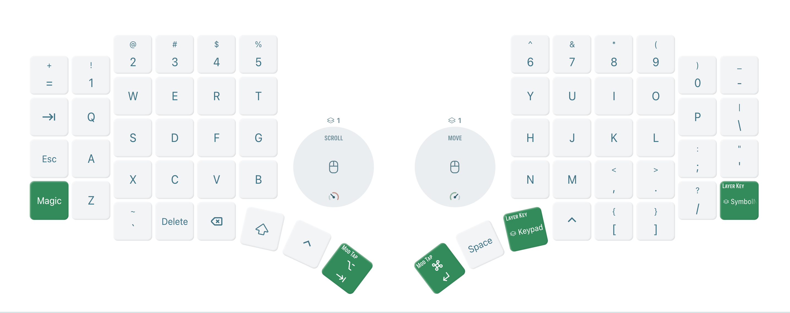
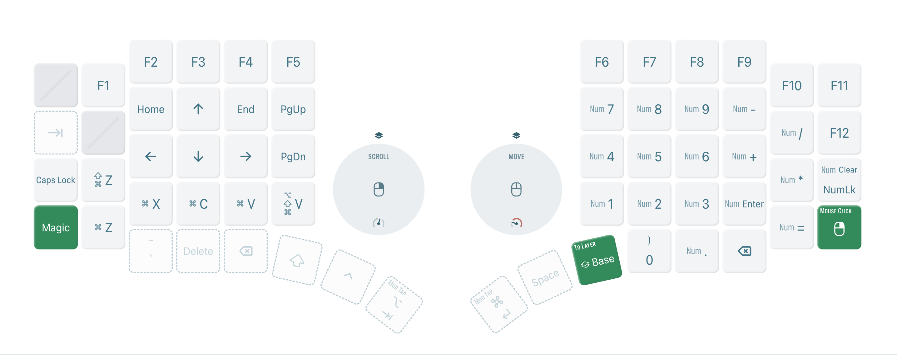
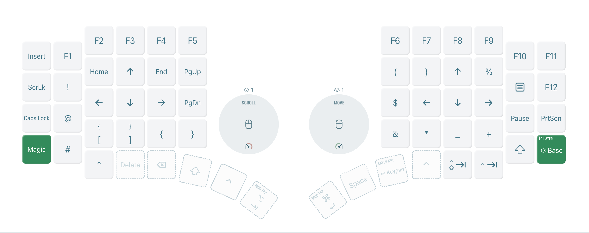
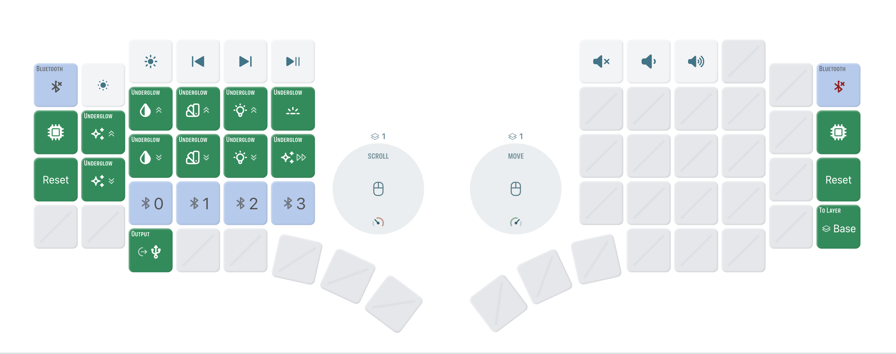

This document contains a visual interface for my Go60 split keyboard. The
keyboard is configured with 4 layers and based on the [ZMK](https://zmk.dev/)
open-source keyboard firmware. If you are interested, you can find the firmware
with my config in the
[MoErgo website](https://my.moergo.com/go60/#/layout/user/14813599-7cb9-4ccf-a6f1-686ecded8314).

The problem with muscle memory is the memory part.

## Layer 0

## Layer 1

## Layer 2

## Layer 3

## References

1. [Go60 User Guide](https://docs.moergo.com/go60-user-guide/)
1. [Customizing Key Layout](https://docs.moergo.com/go60-user-guide/customizing-key-layout/)
