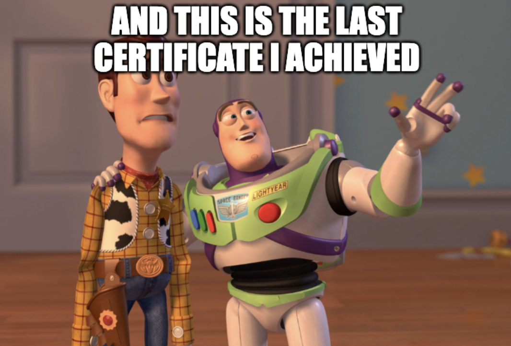
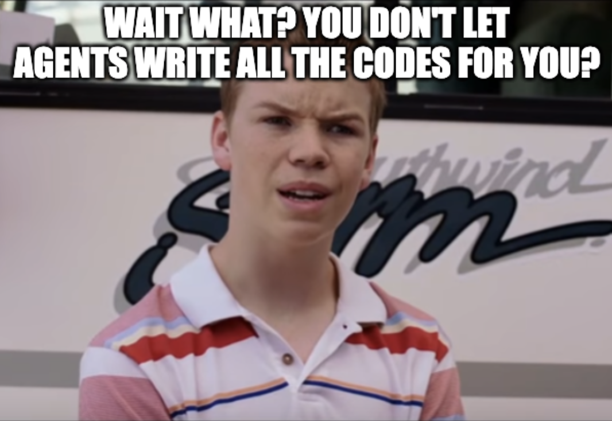

.")

It's first day of August, but the weather in Berlin resembles more an early
winter one. I would have preferred doing a bike tour, but given that I just
completed the first three months into my Earth Observation (EO) career switch, I
do believe that it is important to spend some time doing a recap and wrapping up
everything that happened so far. Three months are a good amount of time, but it
seemed to me that they flew by quicker than an eye blink.

If you are in a hurry and don't have time to read through the entire article,
here is a summary of the first part of this journey:

- I completed **two projects**: the [wildfire-composer] to fetch CEMS Rapid
  Mapping activations and create composite data arrays and imagery for the
  impacted areas, and the [burn-area-detection], a complete end-to-end pipeline
  for the segmentation and assessment of the Achaia-Illia wildfire that happened
  in Greece in 2024. I also started other projects that I will continue in the
  next weeks.
- I read many articles and books, from introductory ones and documentation, to
  scientific papers. My Zotero EO library collection counts more than **50
  references** so far.
- I made **3 small contributions** to the docs of
  [pystac-client](https://github.com/stac-utils/pystac-client/pull/918),
  [xarray](https://github.com/pydata/xarray/pull/11444),
  [rasterio](https://github.com/rasterio/rasterio/pull/3566).
- I published **3 blog posts**:
  [I got laid off](https://eternalspring.xyz/writings/i-got-laid-off/),
  [How to detect and assess wildfires with satellite data](https://eternalspring.xyz/writings/how-to-detect-and-assest-wildfires-with-satellite-data/),
  [Remote sensing fundamentals: from light to spectral signatures](https://eternalspring.xyz/writings/remote-sensing-fundamentals-from-light-to-spectral-signatures/).
  And I have at least three others in draft waiting to be completed.
- I completed **3 courses**: [Cubes & Clouds], [Fundamentals of Remote Sensing],
  and [Basic Principles of Radar Backscatter].

In the next sections, I will be more detailed in reflecting on the following
topics:

- The projects I worked on.
- The theory I learned and the sources I used.
- How I'm approaching the industry.
- How I'm leveraging Large Language Models (LLMs) in this journey.

## Projects

My main goal for the career switch into the EO industry, was to create a bunch
of complete end-to-end projects to showcase in my resume. I already have many
years of experience as a software engineer, and a technical background in
applied math and data-driven optimization. For this reason, I thought that I had
to focus more on showing that I can work on serious and complete applications,
instead of working on many small ones or taking bootcamps just to add more
titles to my LinkedIn profile.

While working on these projects, I also had the chance to create a bunch of very
small PRs to contribute to the docs of packages I experimented with. I know,
only docs, but you have to start somewhere! In the near future, I will surely be
more active and contribute also to the codebase!

### Burn area detection and assessment

The first application I decided to work on, which in hindsight turned out to be
very timely, is burn area detection and assessment. Since this was my first
experience with an EO pipeline, I had to spend a lot of time understanding the
variables involved, the tools, and how to structure my work. It had been many
years since I last used Python, so I had to refresh my skills on a dynamically
typed language :) Coming from languages like Go and Rust, I would say that I
enjoyed using it, and that the language made massive improvements in terms of
developer experience.

While working on this project, I understood how spectral data is used to
discriminate objects based on their electromagnetic fingerprint, and how to use
tools like `rasterio`, `rioxarray`, `xarray`, `geopandas`, and `dask` to design
a data ingestion, processing, and validation pipeline. The entire project is
based on the optical data from the Sentinel-2 mission, in particular on the L2A
product, which contains atmospherically corrected data. What I really enjoyed
was learning that the industry developed standards to access geospatial data,
like the STAC, and that NumPy has been extended to work with chunked and
georeferenced arrays, making developers life much easier!

When I first worked on the burn area detection and assessment, the results and
the methodology were very naive, and I went back to it one month later, after
having worked on other small problems and with a better understanding of the
state-of-the-art stack. In the end, I improved the pipeline, the description of
each phase, and obtained a good score in the validation against the ESA reports.

### Land usage and land cover

The second project I started is the
[land usage and land cover (LULC)](https://github.com/0xstepit/ml-lulc-classification)
classification of a region of Andalusia, in Spain. I found particularly
interesting that changes in land usage are one of the main drivers of climate
change, and that the industry is doing a lot of research into finding ever
better ways to classify lands directly from satellites. The main goal of the
project is to try to develop a data-driven model capable of understanding the
specific usage of a target piece of land by leveraging its **spectro-temporal
behavior**. This project is also based on Sentinel-2 data, and involves the
creation of a 52-channel composite raster made of both spectral bands and
spectral indices. The data assimilation pipeline has been pretty interesting
because I had to scrape multiple regions, trying to find one for which enough
high-quality data was available in all four climatic seasons. In this case,
instead of a notebook-based approach, I decided to proceed with a script-based
solution and to use notebooks only for visual exploration of the results.

One of the goals for the coming weeks will be to complete the LULC
classification. And in order to do so, the next steps are to split the generated
rasters into small chips, and then train and validate the U-Net, which is the
classic data-driven model used for these kinds of applications. The important
aspect of the dataset generation is to take into account the spatial correlation
that can leak information from the training set into the test and validation
ones.

### Deforestation monitoring

I paused the LULC project because I wanted to build something with a bit more
applicability in real life and in line with European legislation. So, I
bootstrapped a project for [deforestation detection][deforestation-detector] to
support the EU Deforestation Regulation (EUDR) compliance evaluation. This
project is also still ongoing, but I have already learned a lot with it, from
the EUDR regulation to the dry and wet seasons of tropical areas. I was not
aware of how different the atmospheric phenomena are based on the latitude, and
I was particularly fascinated by learning about the Intertropical Convergence
Zone (ITCZ) and the trade winds.

### Wildfire composer

Since my goal was to complete at least two projects by the end of month three, I
cheated a bit, and instead of finishing the last two big projects mentioned, I
worked on a new CLI tool. I was probably conditioned by the many wildfires that
occurred in Europe during this summer, and so I implemented a tool called
[wildfire-composer] to populate a DuckDB database out of Copernicus Emergency
Management Service (CEMS) reports. The database is then used to automatically
download pre- and post-fire rasters in the activation areas to create wildfire
visualizations. There are pretty nice extensions that could be added on top of
this tool, like the generation of a CEMS dataset, or the automatic burn
assessment in line with the Achaia-Illia project. But I will leave them for a
future time.

### Neovim BibTex integration

Another interesting tool I worked on, not specific to EO but more related to
writing in general, is a Lua connector between Neovim and BibTeX. Since I'm now
reading a lot of books and articles, it started to be very hard to keep track of
all of them and to be sure to give the correct credit to the sources I use. For
this reason, I decided to dedicate half a day to something that simplifies this
process. With this connector, you can quickly add BibTeX citations to your
Markdown documents directly from Neovim, with fuzzy finding functionalities. If
you are a Neovim user, or you are just interested in the tool, please check it
out in
[this PR](https://github.com/0xstepit/dotfiles/commit/db635271dd3ce1cdb0eafa4aa7d5eee43df71fe8).

## Learnings

The first step in my journey inevitably had to start from the understanding of
some of the theory backing this field. I would say that there is a considerable
amount of open source material available on the Internet to learn about Earth
Observation. The main reason is probably the increasing interest in open source
development arising from the mainstream adoption of machine learning and
decentralized finance systems. Another reason could be the effort that both ESA
and NASA are putting into promoting
[Open Science](https://science.nasa.gov/open-science/) initiatives. Even though
it is awesome that there is so much shared publicly, one of the possible issues
arising from it is the Wikipedia effect: you start hopping from one resource to
the other without really concluding anything.

I'm absolutely not immune, and I hopped between many courses and resources,
eventually losing a lot of context and time. However, I managed to complete
three courses:

- [Basic Principles of Radar Backscatter]: this is the first course I took from
  the [EO College](https://eo-college.org/) to have an introduction to satellite
  imagery. In particular, this course is a basic introduction to SAR. Looking
  back, I would probably have chosen something else since I've only worked on
  optical data in the projects I started but the course itself was well done.
- [Fundamentals of Remote Sensing]: another well done course mainly about
  optical data. I recommend taking this course if you want a quick introduction
  to the electromagnetic spectrum and Earth's surface spectral fingerprints.
- [Cubes & Clouds]: given the huge amount of data, the industry is moving
  quickly towards cloud based solutions. This course is pretty nice and
  introduces both the theory and the practice of using the openEO API and the
  Pangeo stack based on modern Python tools like `xarray`, `dask`, and `odc`.
  The practical sessions are interesting since they guide you through the
  development of a cloud-based pipeline for snow detection and basin discharge
  evaluation in a region of the Alps. The course dedicates also a couple of
  lessons to the Open Science initiative and to the *Findable, Accessible,
  Interoperable, and Reusable* (FAIR) principles.

Other resources I used that I do believe are very useful for understanding the
Geo-Python stack are the
[Introduction to Geospatial Raster and Vector Data with Python] and the
[Cloud Native Remote Sensing with Python], which I still have to complete but
that seems very well done so far.

Together with EO theory, I finally started to focus on learning German! After
almost three years in Berlin, I decided to take German seriously, and now I'm
about to start the B1 course. Even though here people mainly speak English, I do
believe that learning the local language is very useful and interesting to
better understand the culture of the country. Also, it has now been more than
one year that I've been studying Wing Chun, and the classes are in German, so
I'd better learn it quickly and not always rely on friends translating the
lessons in English for me.

## Events

In these months I took part in the following events:

- *Satellite retrievals of land surface temperature & related applications
  webinar* offered by Imperative Space and ESA.
- *Towards foundational AI Models for 3D Point Clouds* from ESA Φ-lab CIN.
- *2nd ESA–NASA Workshop on AI Foundation Models for Earth Observation*.
- Reef goes to Berlin from Vento.

The first three events were online presentations and workshops about different
topics. What I found interesting is the current interest in the quantification
of uncertainties, which was also the main topic of my never-completed PhD. In
particular, in the webinar about land surface temperature, the speaker mentioned
that many times people work on datasets that have been constructed
algorithmically, and then try to assess uncertainties from the already synthetic
source, without propagating errors and confidence intervals from the starting
points. The last event, instead, was an in-person meetup organized by a venture
capital firm that runs a 5-month venture building program and that in the past
helped teams build EO startups.

I've also applied to a couple of in-person workshops but unfortunately I was
rejected every time. I prefer to have the chance to talk in real life with other
participants and organizers, so I hope to have more luck for future
applications. But the competition here is real, since events from ECMWF or ESA
always see many applications from people with real experience in the field...
not like me :)

In the next months, I should start to focus more on connecting with people and
to contact them and companies working on EO applications I like. This step is
fundamental if I want to better understand where the industry is going, and to
get feedback and recommendations from professionals with concrete experience in
EO.

## Large Language Models

I would not be completely transparent if I did not mention that I heavily relied
on LLM systems to help me in this journey. One of the trickiest aspects of this
journey is that I'm completely alone since I don't have any connection with
people working in this industry, and so I needed help to find projects,
understand problems, and guide my research and learning path. Despite that, I
only completed two projects in three months. How is it possible? Well, I didn't
adopt the **Prompt text > Accept > Repeat** workflow. I know, this is probably
your face while reading these lines:

My goal now is not to ship products at the speed of light, or to create random
contributions to open source projects. I do believe that this approach, even
though it might have given me more visibility, was not the best one when my goal
was to understand. In these months I wanted to grasp many things, starting from
how to design an end-to-end pipeline for an EO data problem and the usage of the
most common packages, to something more personal about my career, that is,
whether I really like spending my days on these topics. That being said, yes, I
only accomplished two projects, because I wanted to write every single line of
code to process the data and validate the results. Thanks to this approach, I'm
now more convinced than ever before about my career goals, and I understand
every single bit of theory involved in the topics and problems I tackled.
Moreover, now I also have a pretty clear overview of the stack that I have to
fully master to help shape this industry's development.

## Conclusion

A career switch is not an easy thing, and when you take the decision to do it,
you'd better reflect seriously about what you are doing. For this reason, I do
believe it is important to mention that I didn't go straight into the EO
industry as the only field for my career switch. In the search for something new
and exciting to work on, there were three other topics I was very interested in:
cryptography, with particular focus on zero-knowledge systems, traditional
finance, with focus on ETF providers, and pure deep learning algorithms. I would
say that these fields, together with EO, represent everything that I have been
fascinated by for the last decade. Since I was looking for a decision with a
long term horizon, I dedicated time to all of these topics, finding in EO an
energy and enthusiasm that I had barely felt in my whole career.

So, as a quick recap:

- I used and experimented with many of the EO Python tools: `xarray`, `dask`,
  `pystac`, `odc`, `rasterio`, `rioxarray`, `geopandas`, `duckdb`, `zarr`, and
  `folium`.
- I learned what optical and radar images are, how to work with vector and
  raster data and how to combine them, how to analyze spectral data and
  interpret spectral indices, and I familiarized myself with cloud-native
  formats and pipelines.
- I learned about the FAIR principles, European initiatives in the industry, who
  are the main players, and what top researchers are focusing on.

As always when you start doing something new, the more you learn, the more
questions you start asking yourself. In the next months, I have to find an
answer to these:

- Is it better to continue working on personal projects or to start contributing
  to open-source tools?
- Which kind of role do I want to land in this industry? Data engineer, data
  scientist, or MLOps?
- Does it make sense to start a new master's to get the title and learn the
  theory from the ground up?
- Should I focus on SAR or atmosphere, or continue working with optical data?

You arrived at the end of this article, so many thanks for having shown interest
in my career switch. If you have any recommendation or suggestion, please reach
out. I would love to talk with you and hope to see you again in the next update!

[basic principles of radar backscatter]: https://eo-college.org/courses/basic-principles-of-radar-backscatter/
[burn-area-detection]: https://github.com/0xstepit/burn-area-detection
[cloud native remote sensing with python]: https://courses.spatialthoughts.com/python-remote-sensing.html
[cubes & clouds]: https://eo-college.org/courses/cubes-and-clouds/
[deforestation-detector]: https://github.com/0xstepit/deforestation-detector
[fundamentals of remote sensing]: https://www.earthdata.nasa.gov/learn/trainings/fundamentals-remote-sensing
[introduction to geospatial raster and vector data with python]: https://carpentries-incubator.github.io/geospatial-python/
[wildfire-composer]: https://github.com/0xstepit/wildfire-composer
